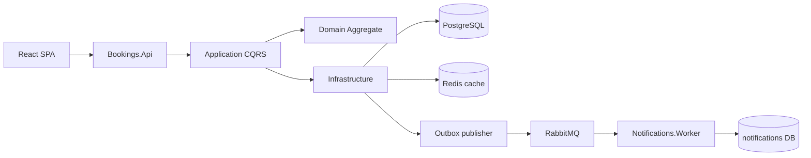
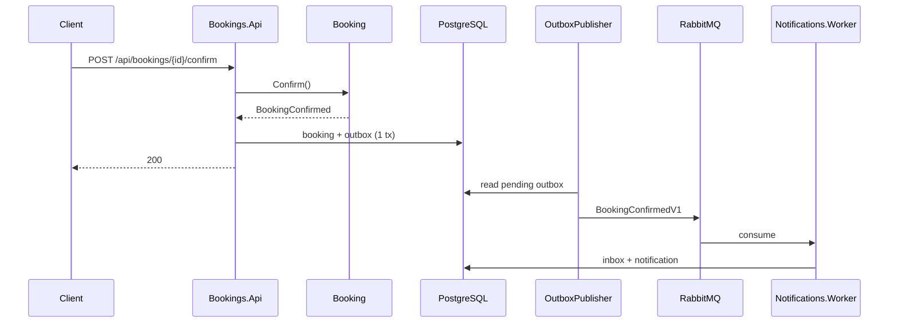

# pt-capitole

Micro-MVP de gestión de reservas (salas/puestos) para la prueba técnica Capitole.

Stack: **.NET 8** (hexagonal + DDD táctico + CQRS/MediatR) · **PostgreSQL** · **Redis** · **RabbitMQ** · **React + Vite**.

## Arranque rápido

```bash
docker compose up --build
```

| Servicio | URL |
|---|---|
| Web | http://localhost:3000 |
| API + Swagger | http://localhost:8080/swagger |
| Health | http://localhost:8080/health |
| RabbitMQ UI | http://localhost:15672 (guest/guest) |
| Redis | localhost:6380 (Docker) / localhost:6379 (local) |

Datos semilla: 3 reservas `Pending` (`Room-A`, `Room-B`, `Desk-12`).

### Local (sin contenedores de app)

```bash
docker compose up -d postgres rabbitmq redis
dotnet run --project src/Bookings.Api
dotnet run --project src/Bookings.Notifications.Worker
cd web && npm install && npm run dev
```

API en `http://localhost:5250` (según `launchSettings`). En el front: `VITE_API_BASE_URL=http://localhost:5250`.

## Tests

```bash
dotnet test
cd web && npm test
```

## Arquitectura



### Flujo al confirmar



## Topología RabbitMQ (MassTransit)

- Exchange: fanout/topic según convención MassTransit para `BookingConfirmedV1` / `BookingCancelledV1`
- Colas: `notifications-confirmed`, `notifications-cancelled`
- Reintentos: 3 intentos, intervalo 2s
- Fallos persistentes: fault/error queues de MassTransit (`*_error`)

## Estructura

```
src/
  Bookings.Domain/
  Bookings.Application/
  Bookings.Infrastructure/
  Bookings.Api/
  Bookings.Contracts/
  Bookings.Notifications.Worker/
web/                  # React 18 + Vite + TanStack Query
tests/
docs/adr/
docker-compose.yml
```

## Variante de frontal

**React** (Vite + TypeScript strict). Motivo: composición sencilla para `GenericTable<T>`, buen encaje con TanStack Query y tests con Vitest/Testing Library.

## ADRs

Ver `docs/adr/` (validación, mediator, solape/concurrencia, outbox, GenericTable).

## Qué haría con más tiempo

- Exclusion constraint GiST en PostgreSQL para solapes Confirmed
- Migraciones EF versionadas (ahora `EnsureCreated` para el MVP)
- SignalR para refresco en vivo
- Tests de arquitectura (NetArchTest) y un e2e Playwright
- OpenTelemetry end-to-end

## Uso de IA

Asistente de código (Cursor) para scaffolding de solución, docker-compose y boilerplate de API/React. Decisiones de dominio, outbox y contratos las revisé y ajusté a mano sobre el enunciado.
